<!-- Elysia-themed profile, v2 (preview). The whole page is one SVG: ./assets/profile.svg -->

  <i>🔮 Computer Vision · Tracking & ReID</i> 
  <a href="https://github.com/HoangDuong-Devs/six-eye">six-eye</a> &nbsp;·&nbsp; <a href="https://github.com/HoangDuong-Devs/boxmot_multicamera">boxmot_multicamera</a> &nbsp;·&nbsp; <a href="https://github.com/HoangDuong-Devs/boxmot">boxmot</a> &nbsp;·&nbsp; <a href="https://github.com/HoangDuong-Devs/Supervision-System">Supervision-System</a> &nbsp;·&nbsp; <a href="https://github.com/HoangDuong-Devs/Face_Alignment">Face_Alignment</a>  
  <i>🌸 AI Agents · Vision-Language · Pipelines</i> 
  <a href="https://github.com/HoangDuong-Devs/Agentic_Object_Detection">Agentic_Object_Detection</a> &nbsp;·&nbsp; <a href="https://github.com/HoangDuong-Devs/Video-Captioning">Video-Captioning</a> &nbsp;·&nbsp; <a href="https://github.com/HoangDuong-Devs/labeling-tool">labeling-tool</a> &nbsp;·&nbsp; <a href="https://github.com/HoangDuong-Devs/ChatbotRasa">ChatbotRasa</a>  
  <i>💎 Apps</i> 
  <a href="https://github.com/HoangDuong-Devs/project-ellie">project-ellie</a>

